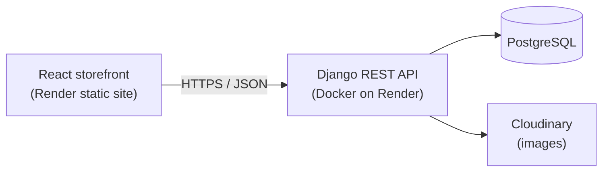

# Souk — multi-vendor e-commerce marketplace

A full-stack marketplace in the style of Amazon / Digikala: shoppers browse and buy,
sellers list and manage their own products. Django REST API + React storefront, deployed live.

**Live demo:** https://ecommerce-frontend-7q36.onrender.com


**API:** https://ecommerce-backend-quog.onrender.com/api/catalog/products/
**Interactive API docs (Swagger):** https://ecommerce-backend-quog.onrender.com/api/docs/
**Frontend repo:** https://github.com/bitokokun/ecommerce-frontend

> Hosted on free tiers, so the first request after a quiet period can take up to a minute while the server wakes up.

## What it does

**Shoppers**
- Browse and search products, filter by 30 categories, pick a variant (size/colour/SKU)
- Cart for guests and for logged-in users
- Checkout with a saved shipping address (country chosen from a list of 196)
- Order history

**Recommendations**
- "You might also like" on every product page, and "Picked for you" on the home page for shoppers with a purchase or a cart
- Every suggestion says why ("Because you bought Wireless Mouse", "Often bought together")

**Sellers**
- Register as a seller, then manage listings from a dashboard (no Django admin needed)
- Create products, add variants and stock, upload photos
- See orders that include their products, with where to ship them, and get an in-app alert when a new one arrives

**Security** (details in the Security section below)
- Rate limiting on login (per address and per account), signup, product writes and image uploads
- Uploaded images are validated with Pillow and size/pixel limits, not trusted by file name; cart quantities and ids are validated
- Cloudflare Turnstile captcha on signup, verified on the server
- Server-side role and ownership checks (only seller accounts create products; only an author edits their review)

## Stack

| Layer | Technology |
|---|---|
| API | Django 5, Django REST Framework, JWT (SimpleJWT), OpenAPI via drf-spectacular |
| Database | PostgreSQL |
| Frontend | React 18, React Router, Vite |
| Images | Cloudinary |
| Packaging / hosting | Docker, Render, WhiteNoise for static files |



More diagrams (data model, checkout sequence, authentication, app structure) are in [docs/architecture.md](docs/architecture.md).

## How the recommendations work

Written from scratch in plain Python (`apps/recommendations/engine.py`), with no ML library, because the catalog is small and the host has 512 MB of RAM.

- **Content similarity.** Each product's name, category and description become a TF-IDF vector; products are compared by cosine similarity. Rare words count for more than common ones. This works with zero sales data.
- **Co-purchase.** Item-item collaborative filtering: how often two products appear in the same order, normalised by how popular each one is. It contributes nothing until orders exist, then improves the results.
- **Blend.** `0.7 * content + 0.3 * co-purchase`. Weak matches are dropped rather than padded out.
- **For a shopper.** Each candidate is scored against what they bought (full weight) and what is in their cart (half weight); items they already have are never suggested.
- The model is cached for 5 minutes. The engine has no Django code in it, and its 19 unit tests run in milliseconds: `python manage.py test apps.recommendations`.

## Design decisions worth knowing

- **Variants are the stocked unit.** `ProductVariant` (SKU, price override, stock) is what gets bought, so sizes and colours don't need a schema change later.
- **Checkout can't oversell or double-charge.** It runs in one transaction, locks the cart and then the variant rows (always in id order, so carts can't deadlock), re-checks stock and decrements it. Two buyers racing for the last unit can't both succeed. Because payment and automatic expiry are not implemented yet, pending orders keep their stock until they are cancelled; this needs a payment/expiry workflow before a real launch.
- **Checkout is idempotent.** Clients send an `Idempotency-Key` header (the storefront generates one per attempt). Repeating a request with the same key returns the original order with `200` and `Idempotent-Replayed: true` instead of creating a second one, and reusing a key with a different address returns `422`. The key is stored in the same transaction as the order, so a failed attempt leaves nothing behind and can be retried. `python manage.py prune_idempotency_keys` removes old keys.
- **Sold products are archived, not deleted.** Deleting a product or variant that appears in an order would orphan the order lines and hide them from the seller, so those requests archive the product (or are refused for a variant).
- **Orders keep their history.** `OrderItem` copies the product name, SKU and price at purchase time, so later edits or deletions don't rewrite past orders.
- **Guest and account carts.** Guests are tracked by session; logging in switches to the account's cart.
- **Seller alerts need no extra table.** "New orders" is computed from existing orders since the seller last looked.
- **Images live on Cloudinary** because Render's disk is wiped on every redeploy.
- **One source of truth for countries.** The server owns the list; the dropdown fetches it and the address serializer validates against it.

## API overview

| Method | Path | Purpose |
|---|---|---|
| POST | `/api/accounts/register/` | Create an account (customer or seller) |
| POST | `/api/auth/token/` | Log in, get JWT |
| GET | `/api/accounts/countries/` | Countries for the address dropdown |
| GET/POST | `/api/accounts/addresses/` | Own shipping addresses |
| GET | `/api/catalog/products/` | Public product list (search, filter, ordering) |
| GET | `/api/catalog/products/{id}/` | Product detail with variants and images |
| GET | `/api/catalog/categories/` | All categories |
| GET | `/api/catalog/products/mine/` | A seller's own products, drafts included |
| POST | `/api/catalog/products/` | Create product (seller accounts only) |
| POST | `/api/catalog/products/{id}/variants/` | Add a variant |
| POST | `/api/catalog/products/{id}/images/upload/` | Upload a photo |
| GET/POST | `/api/cart/`, `/api/cart/items/` | Cart |
| POST | `/api/orders/checkout/` | Turn the cart into an order (supports `Idempotency-Key`) |
| GET | `/api/orders/` | Own order history |
| POST | `/api/orders/{id}/cancel/` | Cancel an order that has not shipped; stock is returned |
| POST | `/api/orders/received/{id}/fulfil/` | Seller marks their own lines shipped or delivered |
| GET/POST/DELETE | `/api/catalog/wishlist/` | Saved products |
| POST | `/api/auth/token/refresh/`, `/api/auth/logout/` | Rotate / revoke refresh tokens |
| GET | `/api/orders/received/` | Orders containing the seller's products |
| GET | `/api/recommendations/similar/{id}/` | Products related to one product |
| GET | `/api/recommendations/for-you/` | Personal picks from purchases and cart |

The full, always-current reference is generated from the code: open `/api/docs/` (Swagger UI) or download `/api/schema/`. Set `API_DOCS_ENABLED=False` to switch it off.

## Run it locally

```bash
cp .env.example .env        # on Windows cmd: copy .env.example .env
docker compose up --build
```

API at http://localhost:8000/api/ and admin at http://localhost:8000/admin/.
`docker-compose.yml` is for local development only (it uses Django's `runserver`). The live
site builds the same `Dockerfile` but runs `start.sh`, which serves with gunicorn.
Create an admin with `docker compose exec web python manage.py createsuperuser`.
The React app is in the [frontend repo](https://github.com/bitokokun/ecommerce-frontend).

## Automated tests

Run the full suite from the project directory:

```powershell
docker compose run --rm web python manage.py test
```

Run one area at a time when investigating a failure:

```powershell
docker compose run --rm web python manage.py test apps.orders.tests_checkout
docker compose run --rm web python manage.py test apps.accounts
docker compose run --rm web python manage.py test apps.catalog
docker compose run --rm web python manage.py test config
```

What is covered:

- **Checkout:** totals and price snapshots, stock deduction, rollback on failure, address ownership, idempotent replays, key validation.
- **Concurrency:** real parallel requests against PostgreSQL (threads): the last unit is sold once, buyers can never oversell, the same key sent four times creates one order, double-submits create one order, opposite cart orders don't deadlock, cancel racing checkout keeps stock consistent.
- **Permissions:** every protected endpoint rejects anonymous users, role checks, cross-seller access to products, variants, images and orders, buyers only see their own orders.
- **Inventory and integrity:** ordered products are archived instead of deleted, ordered variants can't be removed, negative stock is rejected.
- **Authentication:** token rotation and revocation, logout, password change revoking every session, deactivated users, the optional httpOnly cookie mode.
- **Query efficiency:** list and detail endpoints must not issue more queries as the number of rows grows.
- **Errors and docs:** JSON 404/405/400 responses, and the OpenAPI schema must describe checkout and the auth endpoints.

The frontend has its own tests (`node --test`) for token handling and the API client.

The tests don't replace payment-provider testing or production load testing.

## CI/CD

GitHub Actions (`.github/workflows/ci.yml`) runs on every push and pull request:

1. Django system check and `makemigrations --check`, so models and migrations can't drift apart.
2. The full test suite against a PostgreSQL 16 service, including the concurrency tests.
3. OpenAPI schema generation and validation (the schema is uploaded as a build artifact).
4. `check --deploy` with production settings, and a Docker image build.
5. On `main` only, when all of the above pass: a POST to the Render deploy hook, if the `RENDER_DEPLOY_HOOK` secret exists.

To deploy only after CI passes, either turn off auto-deploy in Render and add the deploy hook URL as the `RENDER_DEPLOY_HOOK` repository secret, or keep auto-deploy and set it to wait for CI checks.

## Environment variables

| Name | Purpose |
|---|---|
| `DJANGO_SECRET_KEY` | Required when `DJANGO_DEBUG` is off; 32+ random characters (the app refuses to start otherwise) |
| `DJANGO_DEBUG` | `True` for local development. **Off by default** |
| `DJANGO_ALLOWED_HOSTS` | Hostnames the server answers to |
| `CORS_ALLOWED_ORIGINS` | Comma-separated frontend origin(s) allowed to call the API |
| `DJANGO_ADMIN_URL` | Private path for the admin login (default `admin/`) |
| `POSTGRES_SSLMODE` | Set `require` for a database reached over the internet |
| `POSTGRES_DB` / `USER` / `PASSWORD` / `HOST` / `PORT` | Database connection |
| `CLOUDINARY_URL` | Image storage (optional locally; uploads use local disk without it) |
| `TURNSTILE_SECRET_KEY` | Cloudflare Turnstile secret; skipped only in DEBUG/local development, required for production signup |
| `DJANGO_SUPERUSER_USERNAME` / `EMAIL` / `PASSWORD` | Auto-creates the admin on deploy |
| `AUTH_REFRESH_COOKIE` | `True` keeps the refresh token in an httpOnly cookie instead of the browser's storage (see Security). Default `False` |
| `AUTH_COOKIE_SAMESITE` | `Lax` (default) when the site and API share a registrable domain, `None` when they are on different sites |
| `API_DOCS_ENABLED` | Serve `/api/docs/` and `/api/schema/` (default `True`) |
| `SEED_DEMO` | Set to `1` to fill the shop with demo products on every deploy (`python manage.py seed_demo`, skips ones that exist) |

## Security

Nothing here replaces a professional audit, but these are the measures in place:

- **Secure by default.** `DEBUG` is off unless enabled, and the app will not start in production with a missing, short or placeholder secret key.
- **HTTPS everywhere in production:** redirect to HTTPS, secure cookies, HSTS, no content-type sniffing, no framing. Database connections can be forced to SSL.
- **Tight CORS and hosts.** Only the storefront's origin may call the API from a browser; the JSON-only renderer is used in production (no browsable API).
- **Login hardening.** 10 attempts a minute per address and per account name; access tokens last 15 minutes and renew automatically.
- **Revocable sessions.** Refresh tokens rotate on every use and the old one is blacklisted. Logout, a password change and account deletion all revoke the user's refresh tokens. Run `python manage.py flushexpiredtokens` occasionally to clear expired rows.
- **Tokens out of reach of page scripts.** The access token lives only in memory. Set `AUTH_REFRESH_COOKIE=True` on the API and `VITE_COOKIE_AUTH=true` when building the frontend and the refresh token moves into an httpOnly cookie, so injected scripts can't read it. Browsers only send that cookie reliably when the frontend and API share a registrable domain (for example `shop.example.com` and `api.example.com`); on two different `onrender.com` subdomains the default storage mode is the safer choice.
- **Consistent errors.** Failures return JSON with a `detail` or per-field messages; database conflicts become `409`, unknown API paths return JSON `404`, and unexpected errors return a generic JSON `500`.
- **Authorization checked on the server** for every object: carts, orders, addresses, products, variants, images, reviews.
- **Input checks:** image content is decoded and size-limited, ratings are 1 to 5, cart quantities are 1 to 99, only live products can be bought.
- **Container:** runs as a non-root user; `.dockerignore` keeps `.env` out of images; the local compose file publishes no database port and binds the app to localhost only.
- **Dependencies:** unused packages (Redis, Celery) were removed to shrink the attack surface.

Known limits: in the default mode the refresh token is still kept in the browser's local storage (a cross-site scripting bug would expose it; cookie mode removes that), request-address rate limits can be dodged by someone faking forwarded headers (hence the per-account limit too), and rate-limit counters are per server process.

## Not built yet

- Payment gateway (checkout currently creates a pending order)
- Moderation step before a seller's product goes live
- Email notifications (alerts are in-app only)
- Automatic expiry/release of stock reserved by pending orders
- Two-factor login for the admin, and a content-security-policy header on the storefront
- A separate service for the recommender (it is a clean module today, so it could be split out)
