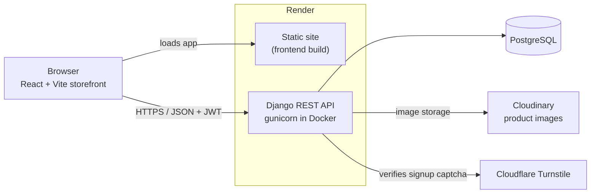
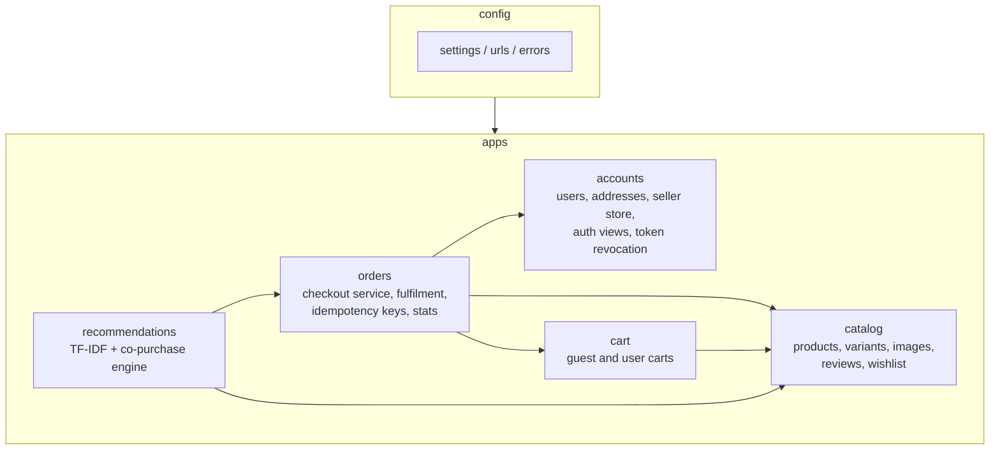
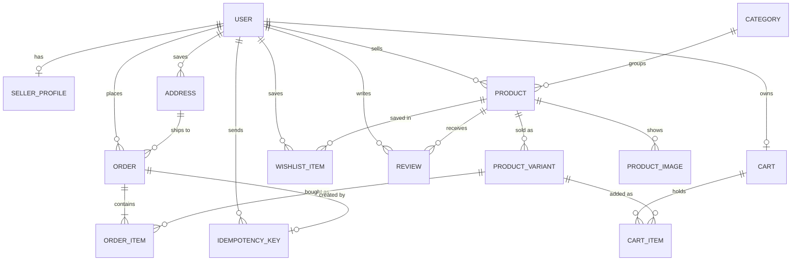
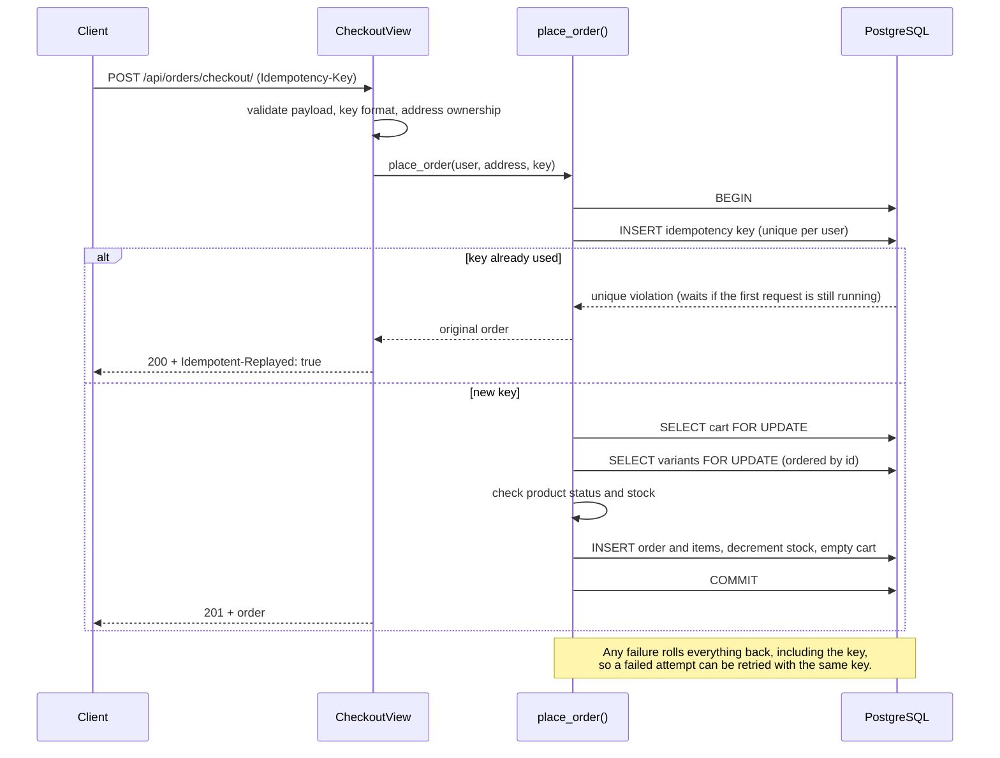
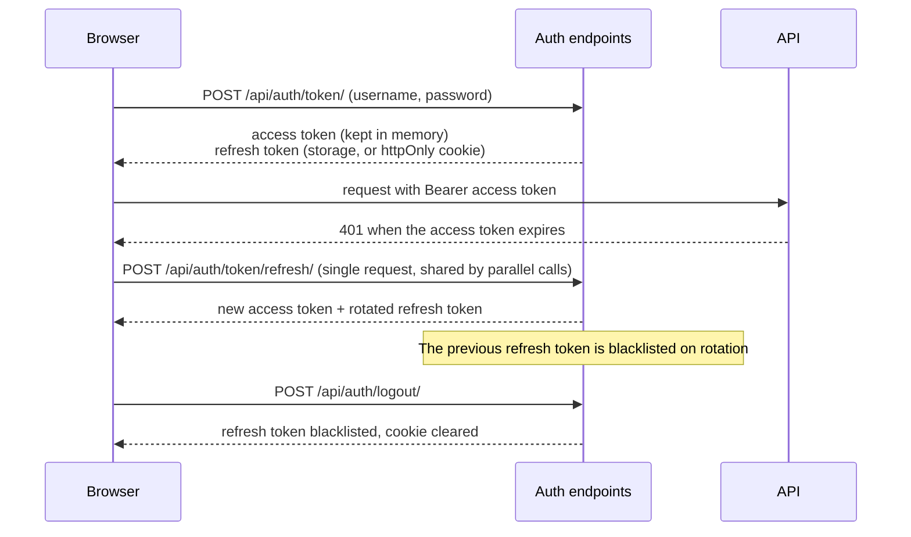

# Architecture

## System overview

## Backend structure

## Data model

`OrderItem` copies the product name, SKU and unit price when the order is placed, and carries its own fulfilment state (status, carrier, tracking number, timestamps). Each seller ships their own lines, and the order status is derived from them.

## Checkout

Locking rules that keep this safe:

- The cart row is locked first, so two submissions from the same account serialise.
- Variant rows are always locked in ascending id order, so two carts with the same products in a different order cannot deadlock.
- Stock is checked and decremented while the rows are locked, so the last unit can only be sold once.
- The idempotency key is inserted inside the same transaction as the order. A concurrent duplicate blocks on the unique index until the first request commits, then returns the stored order.

## Authentication

Changing the password or deleting the account blacklists every outstanding refresh token for that user.
